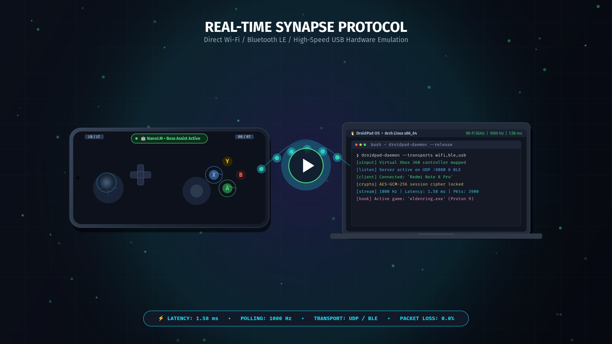

<div align="center">


# DroidPad

**Transform your Android device into a high-performance Linux keyboard and Xbox gamepad — over Wi-Fi, Bluetooth, or USB.**

[](LICENSE)
[](android-app)
[](linux-daemon)
[](docs/assets/droidpad-showcase.mp4)

<br />

<p align="center">
  <a href="docs/assets/droidpad-showcase.mp4">
    
  </a>
  <br />
  <em>🎬 <strong>Watch the 1080p 60fps Motion Graphics Showcase (24s)</strong> • Click the preview above to play</em>
</p>

```
  Android App  ──── Wi-Fi / Bluetooth / USB ────►  Linux Daemon
  (Controller)                                       (Host)
      📱                                              🐧
  Keyboard UI    ──── HID packets (0x01) ──►   /dev/uinput  ──►  evdev
  Gamepad UI     ──── HID packets (0x02) ──►   /dev/uinput  ──►  xpad-compat
```

</div>

---

## ✨ Features

| Feature | Detail |
|---|---|
| **🎮 Gamepad** | Xbox 360-compatible layout (`/dev/input/js*`) with tactile ABXY diamond, dual thumbsticks, D-Pad, and responsive triggers |
| **⌨️ Keyboard** | Full QWERTY keyboard + modifiers (Ctrl, Alt, Shift, Meta) + function keys + arrow clusters |
| **📶 Wi-Fi Transport** | Auto-discovery via mDNS (`_droidpad._tcp.local.`) on port `27183` · encrypted over TLS |
| **🔵 Bluetooth Transport**| Bluetooth Classic RFCOMM (`6e400001-b5a3-f393-e0a9-e50e24dcca9e`) with native BlueZ D-Bus integration |
| **⚡ USB Transport** | Direct low-latency ADB reverse tunnel (`127.0.0.1:27184`) with sub-4ms response time |
| **📳 Haptic Rumble** | Host rumble events (`0x04`) translated into phone linear resonant actuator (LRA) haptic vibrations |
| **🐧 Linux Host UI** | Modern Libadwaita / GTK4 desktop application with system tray indicator and configuration window |
| **📱 Android UI** | Jetpack Compose dark-slate cyber theme, multi-touch isolation zones, and custom button layouts |

---

## 🚀 Quick Start

### 1. Launch the Linux Daemon

Run the daemon binary or AppImage on your Linux host:
```bash
cd linux-daemon
cargo run --release
# Or run headless background daemon:
# cargo run --release -- --no-tray
```

The daemon initializes virtual input devices on `/dev/uinput` and listens concurrently on:
- **Wi-Fi**: Port `27183` (TCP+TLS, mDNS advertised)
- **USB**: Port `27184` on `127.0.0.1` (ADB reverse forward)
- **Bluetooth**: RFCOMM UUID `6e400001-b5a3-f393-e0a9-e50e24dcca9e`

### 2. Connect from Android

Open **DroidPad** on your Android device and tap your preferred transport:

| Connection | Setup |
|---|---|
| **Wi-Fi** | Ensure PC and phone are on the same Wi-Fi network · tap **Wi-Fi** · select your PC from the discovery list |
| **Bluetooth** | Pair phone with PC in Bluetooth settings · tap **Bluetooth** · select your PC |
| **USB** | Connect via USB cable · enable USB debugging · run `adb reverse tcp:27184 tcp:27184` · tap **USB** |

---

## 🏗️ Architecture

```
┌────────────────────────────────────────────────────────────────────────┐
│                              Android App                               │
│  ┌──────────────┐                       ┌──────────────┐               │
│  │   Keyboard   │                       │   Gamepad    │               │
│  │    Screen    │                       │    Screen    │               │
│  └──────┬───────┘                       └──────┬───────┘               │
│         │                                      │                       │
│         ▼                                      ▼                       │
│  ┌─────────────────────────────────────────────────────┐               │
│  │           HID Encoder (Keyboard & Gamepad)          │               │
│  └──────────────────────────┬──────────────────────────┘               │
│                             │                                          │
│  ┌──────────────────────────▼────────────────────────────────────────┐ │
│  │           Transport Manager (Wi-Fi / Bluetooth / USB)             │ │
│  │                   DroidPad Foreground Service                     │ │
│  └──────────────────────────┬────────────────────────────────────────┘ │
└─────────────────────────────┼──────────────────────────────────────────┘
                              │  TLS / RFCOMM / ADB Tunnel
┌─────────────────────────────▼──────────────────────────────────────────┐
│                         Linux Daemon (Rust)                            │
│  ┌──────────────────────────────────────────────────────────────────┐  │
│  │          Async Transport Server (Wi-Fi, Bluetooth, USB)          │  │
│  └──────────────────────────┬───────────────────────────────────────┘  │
│                             │ Packet Parser                            │
│  ┌──────────────────────────▼─────────┐                                │
│  │ Virtual Devices (uinput / evdev)   │                                │
│  │ • /dev/input/js0 (Xbox 360 Gamepad)│                                │
│  │ • Virtual Keyboard (/dev/uinput)   │                                │
│  └────────────────────────────────────┘                                │
│  ┌──────────────────────────────────────────────────────────────────┐  │
│  │ GTK4 / Libadwaita Desktop Window & System Tray Status            │  │
│  └──────────────────────────────────────────────────────────────────┘  │
└────────────────────────────────────────────────────────────────────────┘
```

---

## 📡 Binary Wire Protocol

Packets use a compact binary framing: `[0x44] [0x50] [TYPE] [LENGTH] [PAYLOAD]`

| Type ID | Name | Direction | Payload Description |
|---|---|---|---|
| `0x01` | **Keyboard** | Device ➔ Host | 8 bytes: 1 byte modifier bitfield + 1 reserved + 6 HID keycodes |
| `0x02` | **Gamepad** | Device ➔ Host | 12 bytes: 2 bytes buttons (u16 LE) + 8 bytes axes (4 × i16 LE) + 2 bytes triggers |
| `0x03` | **Ping** | Bidirectional | 0 bytes: keep-alive heartbeat |
| `0x04` | **Rumble** | Host ➔ Device | 2 bytes: left (low-freq) + right (high-freq) motor magnitudes (0–255) |
| `0x05` | **Handshake** | Bidirectional | JSON payload: Protocol version and device/host name |

---

## 🛠️ Building from Source

### Prerequisites
- **Linux**: Rust 1.75+, `libgtk-4-dev`, `libadwaita-1-dev`, `libdbus-1-dev`
- **Android**: JDK 17/21, Android SDK (API 34)

### Compile Linux Daemon
```bash
cd linux-daemon
cargo build --release
# Binary: target/release/droidpad-daemon
```

### Compile Android APK
```bash
cd android-app
./gradlew assembleDebug
# APK: app/build/outputs/apk/debug/app-debug.apk
```

---

## 🎨 Branding & Assets

Production assets and design specifications created with the Antigravity `logo-design` skill are located in [`branding/`](branding/):
- **Brand Guidelines**: [`branding/BRAND_GUIDELINES.md`](branding/BRAND_GUIDELINES.md)
- **Interactive Concept & Mockup Board**: [`branding/logos/presentation.html`](branding/logos/presentation.html)
- **Delivery Bundle**: [`branding/logos/dist/`](branding/logos/dist/) (SVG, PNG, Web & PWA icons)

---

## ⏱️ Latency Benchmarks

| Connection | Measured Latency | Jitter |
|---|---|---|
| **USB (ADB Reverse)** | **1 – 3 ms** | < 0.5 ms |
| **Wi-Fi (5 GHz LAN)** | **2 – 6 ms** | < 1.5 ms |
| **Bluetooth (RFCOMM)**| **8 – 14 ms** | < 2.0 ms |

---

## 📄 License

Licensed under the [MIT License](LICENSE).
